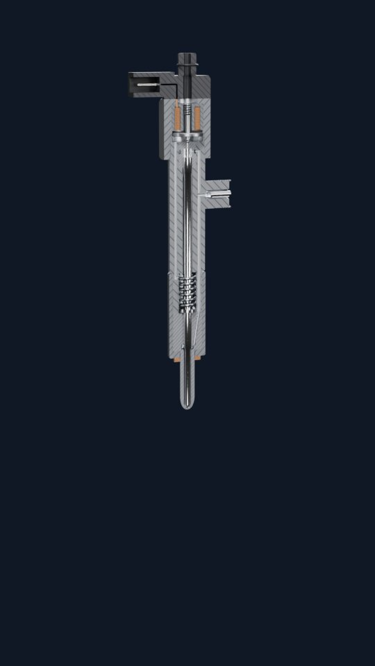

# Injectorul Bosch CRI2 în Blender (22.11.2026)

Injector Bosch CRI2 cu supapă cu bilă (tipul 0445110, până la 1.600 bar), în secțiune, plus chiulasa cu clema. Scena e construită din scriptul `cri2.py` pentru Blender 5.0, fără poze din atelier: proporțiile sunt reconstruite după desenul Bosch cu piesele desfăcute și după brevetele Bosch despre supapa electromagnetică. Se corectează după pozele cu injectorul din atelier.

Folosit în animația „Injectorul Bosch CRI2: cum funcționează” (46 s) și în seria „De ce se strică injectoarele”, varianta 3D (15 filme), ambele din 22.11.2026.

## Fișiere
- `injector_bosch_cri2.blend`: scena gata de deschis (Blender 5.0+, Cycles, materiale procedurale, fără texturi externe). Se deschide pe secțiunea injectorului, cu piesele mobile în repaus, prin camera `cam_full`; F12 randează la 1080×1920.
- `cri2.py`: scriptul care construiește scena de la zero și randează straturile pentru montaj.
- `preview_sectiune.jpg`: cum arată randarea la deschidere.

## Ce e în scenă
Unități: 1 unitate Blender = 1 mm. Axa injectorului = axa Z, vârful duzei la z = 0, planul de secțiune y = 0 (camera privește dinspre y negativ).

| Colecție | Ce conține | La deschidere |
|---|---|---|
| `static` | jumătatea din spate a pieselor fixe: corpul, duza, piulița duzei, șaiba de cupru, piesa supapei, miezul magnetic, piulița magnetului, capacul cu conectorul | vizibilă |
| `coil` | bobina (jumătatea din spate) | vizibilă |
| `static_full` | piesele care nu se taie: filtrul-lamelă, pinul conectorului, firul | vizibilă |
| `g1` | ancora, ghidajul bilei, bila (se mișcă împreună) | vizibilă |
| `g2` | acul, știftul de presiune, pistonul de comandă (se mișcă împreună) | vizibilă |
| `spr_noz`, `spr_arm` | arcul acului, arcul ancorei | vizibile |
| `front` | jumătățile din față ale pieselor fixe: exteriorul și deschiderea secțiunii | ascunsă |
| `fuel_hp`, `fuel_ctrl`, `fuel_lp`, `fuel_sac` | volumele de motorină: înaltă presiune, camera de comandă, retur, sacul duzei; emisie albă, se colorează la montaj (portocaliu, chihlimbar, albastru) | ascunse |
| `head`, `clamp` | chiulasa în secțiune (puț în trepte cu scaunul șaibei la z = 22,2, gaura duzei, cămăși de apă, bujie încandescentă) și clema cu șurubul ei; jocurile din jurul injectorului sunt mărite | ascunse |

Camerele privesc toate din același punct, deci prim-planurile sunt decupaje exacte din planul întreg:

| Cameră | Încadrează |
|---|---|
| `cam_full` | tot injectorul (z −24…158 mm) |
| `cam_valve` | supapa de comandă, ancora și bobina |
| `cam_nozzle` | duza |
| `cam_head` | vârful injectorului în chiulasă, cu clema |
| `cam_guide` | ghidajul acului, arcul acului |

Cursele sunt mărite la animație: acul 2,5 mm, ancora și bila 0,6 mm. Convențiile noastre pentru Blender: fără profunzime de câmp, randare direct la 1080×1920, hașură pe fețele secționate, fețe secționate mate, AgX, mediu de studio cu benzi luminoase (ca piesele cromate să nu reflecte negru).

## Cum îl folosești
**În Blender:** deschizi `injector_bosch_cri2.blend`, aprinzi sau stingi colecțiile din Outliner (de exemplu `front` pentru exterior, `head` și `clamp` pentru injectorul montat în chiulasă, `fuel_*` pentru motorină), alegi camera și dai F12.

**Din linia de comandă** (bpy 5.0.1 de pe PyPI, Python 3.11, ca la `tools/blender_cp4/`):
- `python cri2.py build`: reconstruiește scena în `out/cri2.blend`. Proporțiile se schimbă în profilurile (rază, înălțime) din `build_parts()`, `build_fuel()` și `build_head()`.
- `python cri2.py queue`: randează în `out/` toate straturile pentru montaj (≈ 30 min pe 2 nuclee).
- `python cri2.py render <cameră> <strat> [procent] [eșantioane] [fișier]`: un singur strat, de exemplu `full all` (secțiunea cu piesele mobile), `full ext` (exteriorul), `head headblk` (chiulasa).
- `python cri2.py info`: scrie `out/info.json` (ancore, trasee de curgere, găurile duzei, deplasarea pe mm a pieselor mobile, matricea fiecărei camere) pentru montaj.

Montajul (motorina colorată pe zone de presiune, particulele, piesele mobile mutate cu cursa proiectată, jetul, etichetele) se face în skia-python cu `comp.py` (animația de 46 s) și `bk.py` (trusa folosită în seria injectoarelor). Ele, împreună cu codul seriei, sunt în proiectul Claude „Realizare animatii 3d”: `sursa/injector-cri2-blender/` și `sursa/serie-injectoare-v2/`.
